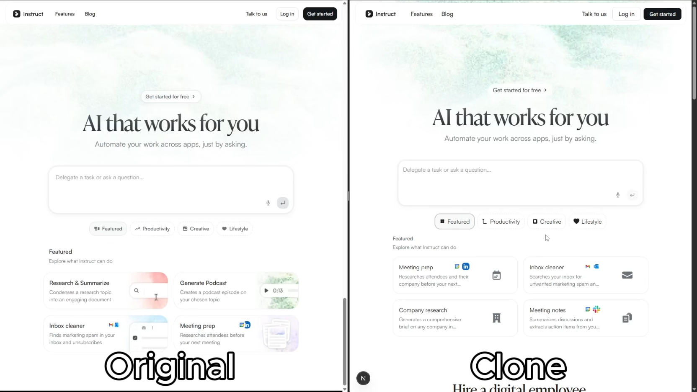
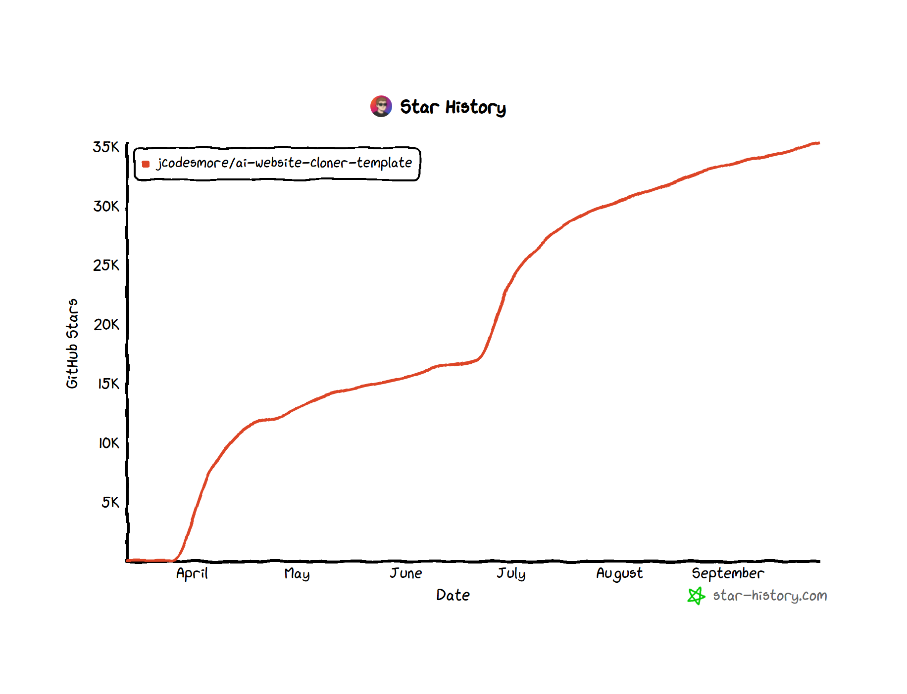

<div align="center">

# AI Website Cloner Template

### Clone any website by its URL

Paste a link to copy a website, then change it by chatting with AI — or build a new site from a prompt, an image or a Figma frame.

[](https://github.com/JCodesMore/ai-website-cloner-template/generate) [](https://discord.gg/hrTSX5yTpB)

[Quick Start](#quick-start) · [Watch Demo](#demo) · [Settings](#settings)

<a href="https://github.com/JCodesMore/ai-website-cloner-template/blob/master/LICENSE"></a> <a href="https://github.com/JCodesMore/ai-website-cloner-template"></a> 

  <a href="https://trendshift.io/repositories/24302?utm_source=repository-badge&amp;utm_medium=badge&amp;utm_campaign=badge-repository-24302" target="_blank" rel="noopener noreferrer"></a> <a href="https://www.star-history.com/jcodesmore/ai-website-cloner-template/"><picture><source media="(prefers-color-scheme: dark)" srcset="https://api.star-history.com/badge?repo=JCodesMore/ai-website-cloner-template&amp;theme=dark" /><source media="(prefers-color-scheme: light)" srcset="https://api.star-history.com/badge?repo=JCodesMore/ai-website-cloner-template" /></picture></a>

</div>

---

## Demo

[](https://youtu.be/O669pVZ_qr0)

> Click the image above to watch the full demo on YouTube.

## Quick Start

You need [Node.js](https://nodejs.org/) 24+.

```bash
npm install
npm run dev
```

Open the address it prints (usually `http://localhost:3000`), paste a website's link into the prompt box and choose **Clone Website**. To build or change sites with AI, add a key first (see [Turning on the AI](#turning-on-the-ai)).

## The SiteCloner App

The app is a studio for building websites and small apps with AI, starting from an idea, a design, or an existing site.

### Starting a project

The start screen has one prompt box and several ways to begin:

| Start from | What happens |
| --- | --- |
| **A prompt** | Describe what you want. The AI builds it as a real project. |
| **Clone Website** | Paste a link. The page is copied with its styles, images and fonts. **Choose pages** lists the site's other pages so you can pick which to include. Anything you type in the prompt box is carried out on the copy afterwards. |
| **Match a Brand** | Paste a brand's site and say what to build. The result follows that site's colors, type and button shapes. |
| **Image to App** | Upload screenshots or mockups to be rebuilt as working pages. |
| **Import Figma** | Paste a link to a Figma frame (needs `FIGMA_TOKEN`). |
| **A template** | Four built-in templates open as projects you can edit. |

Options beside the prompt box:

- **Framework and styling**: React or HTML, with Tailwind CSS or inline styles. React with Tailwind can include the **shadcn/ui** component library.
- **Design system**: a ready-made one, or your own `DESIGN.md` for the AI to follow.
- **Attach**: images, a code snippet, or a Markdown or text file as reference material.
- **Dictate**: speak the prompt (in browsers that support speech recognition).
- Type `/` in an empty prompt for a command menu.

### The workspace

| View | What it is for |
| --- | --- |
| **Chat** | Ask for changes in plain language. Attach files, or pick elements in the preview first so the request is about them. Requests keep running if you close the tab. |
| **Preview** | The running project at desktop, tablet and phone widths. **Select elements** to refer to them in the chat, or **Edit text** directly in the page and apply the changes. |
| **Code** | Browse, edit and save any file. |
| **Data** | A small database per project: tables, rows, CSV import and export. Ask the AI for "a form that saves submissions" and it creates the table and wires up the page. |
| **Flow** | A map of the project's screens and the links between them. |

Also in the header: **History** (undo any change), **Export** (a ZIP of the code), and **Publish** (a snapshot at `/p/<project>/` with a link and QR code; the link works wherever this app is reachable).

### Turning on the AI

Everything except cloning, code editing, export and publish needs an AI key:

1. Create a key in [Google AI Studio](https://aistudio.google.com/) (Gemini), or use a Claude API key.
2. Copy `.env.example` to `.env.local` and set `GEMINI_API_KEY` (or `ANTHROPIC_API_KEY`).
3. Restart the app.

Free Gemini keys work, with limits: only the Flash models, about five requests a minute per model, and occasional "busy" responses. The app paces itself and switches between models, so a build can take a few minutes.

### Settings

| Variable | Purpose |
| --- | --- |
| `GEMINI_API_KEY` | Enables the AI through Google Gemini. |
| `GEMINI_MODELS` | Gemini models to use, in order. Default `gemini-3.8-flash,gemini-3.6-flash,gemini-3.5-flash`. |
| `GEMINI_RPM` | Requests per minute each Gemini model allows for your key. Default `5`. |
| `ANTHROPIC_API_KEY` | Enables the AI through the Claude API instead (used when no Gemini key is set). |
| `CLONER_AI_MODEL` | Claude model to use. Default `claude-opus-5-5`. |
| `ANTHROPIC_BASE_URL` | Send Claude API requests to an Anthropic-compatible service instead. Give the address without `/v1`, and set `CLONER_AI_MODEL` to a model that service offers. |
| `CLONER_AI_PROVIDER` | `gemini` or `anthropic`, to choose when keys for both are set. |
| `CLONER_AI_FALLBACK` | `gemini` or `anthropic`: a second service that takes over when the main one can't finish a request. Requests with images go first to whichever service can read them. |
| `CLONER_AI_IMAGES` | Set to `off` when the AI service does not pass images to the model. Image to App is then unavailable and attached images are not shown to the AI. |
| `FIGMA_TOKEN` | A Figma personal access token, for **Import Figma**. |
| `CLONER_DATA_DIR` | Where projects are stored. Default `.clones/` in the project folder. |
| `CLONER_ALLOW_PRIVATE_HOSTS` | Set to `1` to allow cloning `localhost` and private-network sites. |

### Good to know

- A clone is a **static copy** of what the server sends. Pages that build their content in the browser may need **Keep JavaScript** turned on, and features that rely on a backend (logins, carts, search) do not work in a copy.
- React projects can use `react`, `react-dom`, `react-router-dom`, `lucide-react` and `clsx`; with shadcn/ui also `@base-ui/react`, `class-variance-authority` and `tailwind-merge`. Exported React projects are ordinary Vite projects.
- The AI cannot generate images. It draws with SVG and CSS, uses images you attach, and marks stock photos as placeholders.
- A project's database is served by this app, so pages that use it need the app running at the same address. Tables are private by default: visitors can add rows, only you can read them.
- Projects are stored on the machine running the app. On hosts with a read-only or temporary filesystem (such as Vercel), point `CLONER_DATA_DIR` at persistent storage or run the app on a server or in Docker.
- The app has no sign-in. Anyone who can reach it can create, edit and delete projects, so put it behind your own access control before exposing it to the internet.
- The server refuses to fetch private and local network addresses unless `CLONER_ALLOW_PRIVATE_HOSTS=1`.

## Tech Stack

- **Next.js 16** — App Router, React 19, TypeScript strict
- **shadcn/ui** — Base UI primitives + Tailwind CSS v4
- **Tailwind CSS v4** — oklch design tokens
- **Lucide React** — icons
- **three.js** — the start screen's animated 3D backdrop (loaded on demand)

## Use Cases

- **Platform migration** — rebuild a site you own from WordPress/Webflow/Squarespace into a modern Next.js codebase
- **Lost source code** — your site is live but the repo is gone, the developer left, or the stack is legacy. Get the code back in a modern format
- **Learning** — deconstruct how production sites achieve specific layouts, animations, and responsive behavior by working with real code

## Not Intended For

- **Phishing or impersonation** — this project must not be used for deceptive purposes, impersonation, or any activity that breaks the law.
- **Passing off someone's design as your own** — logos, brand assets, and original copy belong to their owners.
- **Violating terms of service** — some sites explicitly prohibit scraping or reproduction. Check first.

## Project Structure

```
src/
  app/              # Pages, API routes, and the preview and publish servers
  components/
    cloner/         # Start screen and workspace
    ui/             # shadcn/ui primitives
  lib/
    cloner/         # Cloning engine, storage, undo, ZIP
    ai/             # AI agent, providers, prompts and tools
    build/          # Builds projects for preview (esbuild, Tailwind)
    projects/       # Project creation, templates, design systems
    data/           # Per-project database
    export/         # React and Vue exporters
  hooks/            # Custom React hooks
  types/            # TypeScript interfaces
public/sc-bridge.js # Runs inside the preview frame
templates/          # Built-in templates and the shadcn/ui kit for projects
.clones/            # Your projects (git-ignored)
AGENTS.md           # Instructions for coding agents
CLAUDE.md           # Claude Code config (imports AGENTS.md)
```

## Commands

```bash
npm run dev    # Start dev server
npm run build  # Production build
npm run lint   # ESLint check
npm run typecheck # TypeScript check
npm run check  # Run lint + typecheck + build
```

### If using docker

```bash
docker compose up app --build # build and run the app
docker compose up dev --build # run the app in dev mode on port 3001
```

## Star History



## License

MIT
