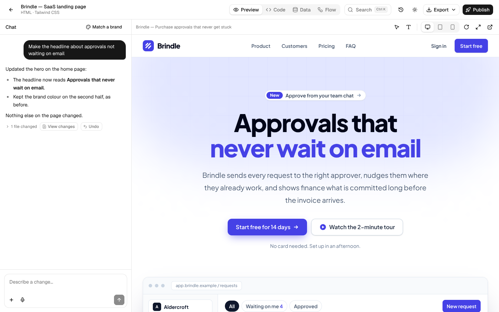
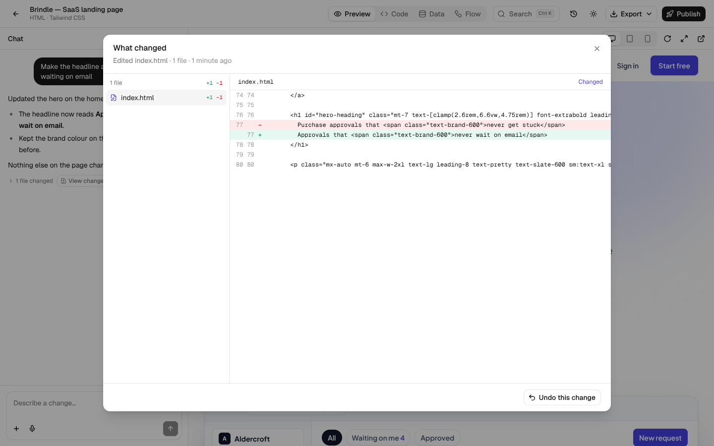
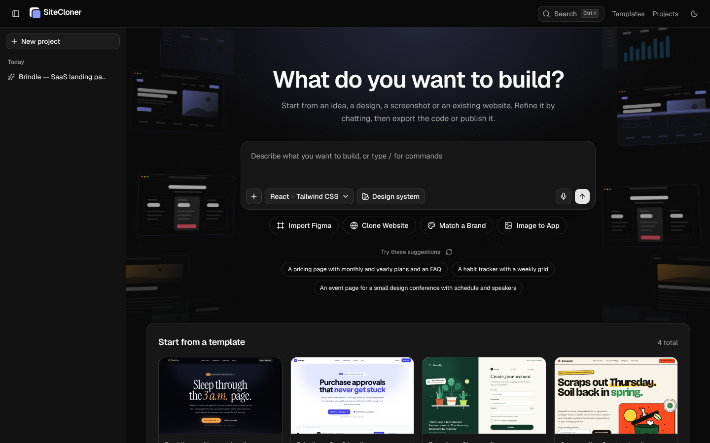

<div align="center">

# SiteCloner

### Clone a website or build a new one, then refine it by chatting with AI

Paste a link to copy a site, or start from a prompt, a screenshot, a brand or a Figma frame. Ask for changes in plain language, see exactly what each one changed, then export the code or publish a link.

[Quick Start](#quick-start) · [Features](#features) · [Turning on the AI](#turning-on-the-ai) · [Settings](#settings) · [Development](#development)

<a href="LICENSE"></a>  

</div>



## Quick Start

You need [Node.js](https://nodejs.org/) 24 or newer. Google Chrome or Microsoft Edge is recommended: the cloner uses it to copy pages that build their content with JavaScript.

```bash
git clone https://github.com/AI1120/website-cloner.git
cd website-cloner
npm install
npm run dev
```

Open the address it prints (usually `http://localhost:3000`), paste a website's link into the prompt box and choose **Clone Website**. Cloning, code editing, export and publishing work straight away. To build or change sites with AI, add a key first (see [Turning on the AI](#turning-on-the-ai)).

## Features

### Start a project

The start screen has one prompt box and several ways to begin:

| Start from | What happens |
| --- | --- |
| **A prompt** | Describe what you want. The AI builds it as a real project. |
| **Clone Website** | Paste a link. The page is copied with its styles, images and fonts. With **Load in a browser** on (the default when Chrome or Edge is installed), each page is opened in a real browser first, so content its scripts add is copied too. **Choose pages** lists the site's other pages so you can pick which to include. Anything you type in the prompt box is carried out on the copy afterwards. |
| **Match a Brand** | Paste a brand's site and say what to build. The result follows that site's colors, type and button shapes. |
| **Image to App** | Upload screenshots or mockups to be rebuilt as working pages. |
| **Import Figma** | Paste a link to a Figma frame (needs `FIGMA_TOKEN`). |
| **A template** | Four built-in templates open as projects you can edit. |

Options beside the prompt box:

- **Framework and styling**: React or HTML, with Tailwind CSS or inline styles. React with Tailwind can include the **shadcn/ui** component library.
- **Design system**: a ready-made one, or your own `DESIGN.md` for the AI to follow.
- **Attach**: images, a code snippet, or a Markdown or text file as reference material.
- **Dictate**: speak the prompt (in browsers that support speech recognition).
- Type `/` in an empty prompt for a command menu.

### Work on it in the workspace

| View | What it is for |
| --- | --- |
| **Chat** | Ask for changes in plain language. Attach files, or pick elements in the preview first so the request is about them. Requests keep running if you close the tab. |
| **Preview** | The running project at desktop, tablet and phone widths. **Select elements** to refer to them in the chat, or **Edit text** directly in the page and apply the changes. |
| **Code** | Browse, edit and save any file, in an editor with syntax colours, line numbers, folding and search (<kbd>Ctrl</kbd>+<kbd>F</kbd>); <kbd>Ctrl</kbd>+<kbd>S</kbd> saves. |
| **Data** | A small database per project: tables, rows, CSV import and export. Ask the AI for "a form that saves submissions" and it creates the table and wires up the page. |
| **Flow** | A map of the project's screens and the links between them. |

In the header:

- **History**: every change, newest first. View any change, or undo it (undoing a change also undoes the ones made after it).
- **Export**: a ZIP of the code. Static sites can also be exported as a Vite project with React or Vue pages.
- **Publish**: a snapshot at `/p/<project>/` with a link and QR code. The link works wherever this app is reachable; later changes stay private until you update it.

### See what changed

Each AI reply that edited files lists them under the reply, with **View changes** and **Undo**. **View changes** opens every file the change touched, before and after, line by line. The same view opens from **History** for any change, including your own edits in the Code view.



### Search and commands

Press <kbd>Ctrl</kbd>+<kbd>K</kbd> (<kbd>⌘</kbd>+<kbd>K</kbd> on a Mac), or click **Search**, to switch views, open another project, export, publish, undo the latest change, rename the project or change the theme. It works while the preview has focus too.

### Light and dark

The sun/moon button switches between light, dark and matching your device. The choice is remembered in each browser.



### Keyboard shortcuts

| Keys | Where | Does |
| --- | --- | --- |
| <kbd>Ctrl</kbd>/<kbd>⌘</kbd>+<kbd>K</kbd> | Anywhere | Search and commands |
| <kbd>/</kbd> | Empty start prompt | Command menu |
| <kbd>Enter</kbd> / <kbd>Shift</kbd>+<kbd>Enter</kbd> | Prompt boxes | Send / new line |
| <kbd>Ctrl</kbd>/<kbd>⌘</kbd>+<kbd>S</kbd> | Code view | Save the open file |
| <kbd>Esc</kbd> | Preview, selecting elements | Stop selecting |
| <kbd>Enter</kbd> | Preview, editing text | Finish the edit |
| <kbd>Ctrl</kbd>/<kbd>⌘</kbd>+<kbd>Enter</kbd> | Data view, row form | Save the row |

## Turning on the AI

Everything except cloning, code editing, export and publish needs an AI key:

1. Create a key in [Google AI Studio](https://aistudio.google.com/) (Gemini), or a Claude API key in the [Anthropic Console](https://console.anthropic.com/).
2. Copy `.env.example` to `.env.local` and set `GEMINI_API_KEY` (or `ANTHROPIC_API_KEY`).
3. Restart the app.

Free Gemini keys work, with limits: only the Flash models, about five requests a minute per model, a small daily allowance, and occasional "busy" responses. A build takes several requests, so on a free key it can take a few minutes and you may only get a handful a day. The app paces itself and switches between models to stay within the limits. A paid Gemini key or a Claude API key makes every AI feature faster and more dependable, and needs no other change than the key in `.env.local`.

## Settings

Set these in `.env.local` (see `.env.example`) and restart the app.

| Variable | Purpose |
| --- | --- |
| `GEMINI_API_KEY` | Enables the AI through Google Gemini. |
| `GEMINI_MODELS` | Gemini models to use, in order. Default `gemini-3.8-flash,gemini-3.6-flash,gemini-3.5-flash`. |
| `GEMINI_RPM` | Requests per minute each Gemini model allows for your key. Default `5`. |
| `ANTHROPIC_API_KEY` | Enables the AI through the Claude API instead (used when no Gemini key is set). |
| `CLONER_AI_MODEL` | Claude model to use. Default `claude-opus-5-5`. |
| `ANTHROPIC_BASE_URL` | Send Claude API requests to an Anthropic-compatible service instead. Give the address without `/v1`, and set `CLONER_AI_MODEL` to a model that service offers. |
| `CLONER_AI_PROVIDER` | `gemini` or `anthropic`, to choose when keys for both are set. |
| `CLONER_AI_FALLBACK` | `gemini` or `anthropic`: a second service that takes over when the main one can't finish a request. Requests with images go first to whichever service can read them. |
| `CLONER_AI_IMAGES` | Set to `off` when the AI service does not pass images to the model. Image to App is then unavailable and attached images are not shown to the AI. |
| `FIGMA_TOKEN` | A Figma personal access token, for **Import Figma**. |
| `CLONER_DATA_DIR` | Where projects are stored. Default `.clones/` in the project folder. |
| `CLONER_ALLOW_PRIVATE_HOSTS` | Set to `1` to allow cloning `localhost` and private-network sites. |
| `CLONER_BROWSER` | The browser used to load pages before copying them. Chrome or Edge is found in its usual install folder; set a path to use another Chromium browser, or `off` to copy pages as the server sends them. |

`GOOGLE_API_KEY`, `GEMINI_MODEL`, `ANTHROPIC_AUTH_TOKEN` and `FIGMA_ACCESS_TOKEN` are also accepted, as alternative names for the matching settings above.

## Running with Docker

```bash
docker compose up app --build   # production build, on port 3000 (set PORT to change it)
docker compose up dev --build   # dev mode, on port 3001 (set DEV_PORT to change it)
```

Both read `.env.local`. Projects are kept inside the container, so they are lost when it is rebuilt; to keep them, mount a volume and point `CLONER_DATA_DIR` at it.

## Good to know

- A clone is a **static copy** of the page as a visitor sees it: loaded in a browser when one is available, otherwise as the server sends it. Features that rely on a backend (logins, carts, search) do not work in a copy. **Keep JavaScript** keeps the site's scripts running in the copy instead; pages then load as the server sends them, since their scripts rebuild them.
- The cloning browser never reaches the network itself: every request it makes goes through the same checks as the rest of the app, so it can't reach private or local addresses. The Docker image has no browser, so clones made there use the server's markup.
- React projects can use `react`, `react-dom`, `react-router-dom`, `lucide-react` and `clsx`; with shadcn/ui also `@base-ui/react`, `class-variance-authority` and `tailwind-merge`. Exported React projects are ordinary Vite projects.
- The AI cannot generate images. It draws with SVG and CSS, uses images you attach, and marks stock photos as placeholders.
- A request keeps running if you close the tab, but one in progress is lost if the app itself restarts. Send "continue" to pick it up.
- A project's database is served by this app, so pages that use it need the app running at the same address. Tables are private by default: visitors can add rows, only you can read them.
- Projects are stored on the machine running the app. On hosts with a read-only or temporary filesystem (such as Vercel), point `CLONER_DATA_DIR` at persistent storage or run the app on a server or in Docker.
- The app has no sign-in. Anyone who can reach it can create, edit and delete projects, so put it behind your own access control before exposing it to the internet.
- The server refuses to fetch private and local network addresses unless `CLONER_ALLOW_PRIVATE_HOSTS=1`.

## Use it responsibly

Good uses:

- **Platform migration**: rebuild a site you own from WordPress, Webflow or Squarespace as plain HTML, React or Vue code you control.
- **Lost source code**: your site is live but the code is gone, the developer left, or the stack is outdated. Get it back in a modern format.
- **Learning**: see how production sites achieve their layouts and responsive behavior by working with real code.

Not for:

- **Phishing or impersonation**: never use it for deception, impersonation or anything that breaks the law.
- **Passing off someone else's design as your own**: logos, brand assets and original text belong to their owners.
- **Breaking terms of service**: some sites prohibit copying or reproduction. Check first.

## Development

```bash
npm run dev        # Start the dev server
npm run build      # Production build
npm run lint       # ESLint
npm run typecheck  # TypeScript
npm run check      # lint + typecheck + build
```

Run `npm run check` before pushing. Coding agents should read `AGENTS.md` (Claude Code picks it up through `CLAUDE.md`), which covers the architecture and the rules for new code. Changes are listed in [CHANGELOG.md](CHANGELOG.md).

### Tech stack

- **Next.js 16**: App Router, React 19, TypeScript strict
- **shadcn/ui**: Base UI primitives with Tailwind CSS v4 and oklch design tokens
- **Lucide React**: icons
- **three.js**: the start screen's animated backdrop, loaded on demand
- **esbuild** and **Tailwind CSS**: build each project for the preview
- **Gemini** or the **Claude API**: the AI

### Project structure

```
src/
  app/              # Pages, API routes, and the preview and publish servers
  components/
    cloner/         # Start screen, workspace, command palette, change viewer
    ui/             # shadcn/ui primitives and toasts
  lib/
    cloner/         # Cloning engine, storage, undo and change history, ZIP
    ai/             # AI agent, providers, prompts and tools
    build/          # Builds projects for preview (esbuild, Tailwind)
    projects/       # Project creation, templates, design systems
    data/           # Per-project database
    export/         # React and Vue exporters
  hooks/            # Custom React hooks (theme, storage, speech)
  types/            # TypeScript interfaces
public/sc-bridge.js # Runs inside the preview frame
templates/          # Built-in templates and the shadcn/ui kit for projects
docs/assets/        # Screenshots for this README
.clones/            # Your projects (git-ignored)
AGENTS.md           # Instructions for coding agents
CLAUDE.md           # Claude Code config (imports AGENTS.md)
```

## Credits and license

SiteCloner started from [JCodesMore/ai-website-cloner-template](https://github.com/JCodesMore/ai-website-cloner-template). Released under the [MIT License](LICENSE).
